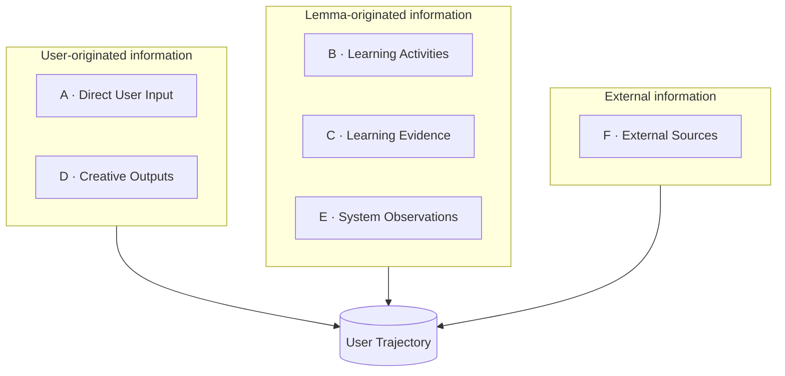

# Trajectory Input Sources · What may enter a user's trajectory, and where it comes from

> **Baseline** `practice-system @ 6474d712` · **Date** 2026-11-02 · **Status** design note; the taxonomy is provisional, and each claim is tagged below
> **Upstream** [`evidence-flow.md`](evidence-flow.md) §10 (Trajectory semantics) · [`../design/trajectory.md`](../design/trajectory.md) (interaction) · [`learner-state.md`](learner-state.md) · [`../design/adaptive-insight.md`](../design/adaptive-insight.md)
> **Scope** which information may enter a User Trajectory, and where it originates. **Not** in scope: the integration pipeline, storage schema, API, or UI.

**Tags used in this document**

| Tag | Meaning |
|---|---|
| `[Decided]` | Already agreed elsewhere; cited, not re-decided here |
| `[Hypothesis]` | Accepted for now, falsifiable; see §6 |
| `[Open]` | No answer yet; do not resolve it silently in code |

---

## 1 · Overview

### 1.1 Why one input is not enough

A trajectory built from a single source records what the product saw, not what the person did.

| Failure | What it looks like |
|---|---|
| **Absence reads as absence** | A user who has not practiced inside Lemma looks the same as a user who cannot. The record cannot separate "did not" from "did it somewhere else". |
| **Coverage follows the product** | The record grows where features write rows — conversations, page edits — not where the person spent the week. |
| **Development outside Lemma is invisible** | A repository, a thesis, a job. For an adult learner this is often where the durable change happens, and none of it is observable from inside. |

`[Hypothesis]` **User Trajectory should capture a user's continuous development, not merely their activity within Lemma.**

This is a direction, not a product definition. It states what the record should be able to hold; it does not yet say which of it ships first.

### 1.2 What the system reads today

`backend/services/trajectory_service.py` assembles a flat event stream from nine tables. Every one of them is Lemma-internal:

| Event kind | Table | Line |
|---|---|---|
| `material` | `pages` | :178 |
| `annotation` | `blocks` | :211 |
| `goal` | `space_goals` | :234 |
| `memory` | `space_memory` | :256 |
| `conversation` | `ai_conversations` | :278 |
| `evidence` | `knowledge_evidence` | :306 |
| `bundle` | `board_context_bundles` | :333 |
| `decision` | `coordinator_decisions` | :355 |
| `notification` | `notifications` | :389 |

Three properties of that read path matter for this document:

- **Only `evidence` carries `item_id`** (:63-67) — so most events cannot be attached to a knowledge point. The module says so rather than guessing.
- **Provenance is not always exact.** `blocks` has no timestamp (it uses the page's `updated_at`); `notifications` has no space field (it uses `meta["projectId"]`, and counts the rest as `unattributed`). Both are marked `at_accuracy = approx` instead of being rounded silently.
- **There is no judgement field.** The stream says what happened and where to look. It does not say what changed — that requires evidence, and today no source produces it at that level.

Coverage of the six source categories discussed in §2:

| Source | Coverage today |
|---|---|
| **A** Direct User Input | Partial — `space_goals` holds goals as recorded. Self-description, reflections, corrections and direction changes have no dedicated input. |
| **B** Learning Activities | Uneven — only surfaces that write one of the nine tables appear. |
| **C** Learning Evidence | One narrow path — `knowledge_evidence`, admitted through `admit_outcome`. |
| **D** Creative Outputs | Not as artifacts. A page appears as `material` (creation, edit); there is no artifact-level identity and no version. |
| **E** System Observations | None. `decision` is a system decision, not an observation about the user. |
| **F** External Sources | None. |

### 1.3 Three axes that must not be collapsed

| Axis | Question it answers | Example |
|---|---|---|
| **Input source** | Where did this come from, and who produced it? | GitHub, a Focus session, the user's own statement |
| **Data type** | What form is it in? | Text, code, a score, an event row |
| **Semantic dimension** | What does it mean for the trajectory? | An output, an activity, a piece of evidence, an interest signal |

A source is not a type, and neither is a meaning. §4 keeps the separations that follow from this.

### 1.4 Decisions this document relies on

These are `[Decided]` elsewhere. They constrain the input design and are not reopened here.

1. **Trajectory is a projection.** It is the existing semantic sources laid on a time axis — not a second Evidence System ([`evidence-flow.md`](evidence-flow.md) §10).
2. **Every node answers four questions.** What happened → what changed → why we think so → what this changes. Missing the third is a log; missing the fourth is an invented story (same section).
3. **State is derived, never stored as history, and no numbers leave it** — no percentages, no mastery scores, no weights ([`learner-state.md`](learner-state.md):38).
4. **Facts are selected by deterministic rules; language is generated afterwards.** Producing nothing is a first-class outcome ([`../design/adaptive-insight.md`](../design/adaptive-insight.md) §4.2).
5. **Not every result may become evidence.** Verdicts are not boolean — `supported / partially_supported / unsupported / ungradable / pending` — and `ungradable`, `pending` are non-signalling (`backend/services/practice/contracts.py`:41-51). A result without a reliable knowledge item does not become evidence at all (`backend/services/practice/evidence.py`:1-11).

---

## 2 · Input sources taxonomy

Six categories, currently under discussion. Each answers *where does this come from* — not *what is it* and not *what does it prove*.

### A · Direct User Input

Information the user provides about themselves, deliberately.

| Signal | Typical form |
|---|---|
| Self-description | "I studied philosophy", "I work as a backend engineer" |
| Interests | topics followed, stated curiosity, what they keep returning to |
| Goals & aspirations | an exam date, a career intent, "I want to read papers without translation" |
| Reflections | "this explanation is the first one that made it click" |
| Corrections | "that is not what I meant"; disagreement with a system judgement |
| Direction changes | dropping a goal, switching fields, pausing for a month |

> **Explicit information is authoritative about what the user says, not about whether it is true.**
> "I already know Rust" is a claim. It becomes capability evidence only once something tests it. Storing it as a claim — and not as state — is what keeps the two apart.

### B · Learning Activities

What the user does inside Lemma.

| Surface | Activity |
|---|---|
| Learn Space | reading, discussing, taking notes |
| Free Course | working through lessons |
| Focus Mode | asking, answering, practicing |
| Whiteboard | thinking, deriving, organizing knowledge |
| Projects | the research, work and artifacts the user builds |

> **Activity describes what happened. It does not automatically establish what the user learned.**

Whether an activity becomes evidence is a separate admission step (§2.C, §4.2). An activity row and an evidence row are different objects, even when they describe the same moment.

### C · Learning Evidence

Information that can support a claim about the user's state or capability.

| Evidence | What it supports |
|---|---|
| Correctness and error patterns | whether a specific item held, and how it failed |
| The user's own explanation of a concept | understanding versus recognition |
| Independent reasoning, shown step by step | capability without assistance |
| Transfer to an unfamiliar context | that the knowledge is usable, not just recallable |
| Task completion | that a unit of work was finished |
| Structured evaluation by an agent | a judgement with a stated method and confidence |

> **Activity describes behavior; evidence supports an interpretation of that behavior.**

The existing admission door is `evidence_entry.admit_outcome` (three production call sites: `api/v1/knowledge.py`:125, `conversation_tool_service.py`:603, `services/practice/evidence.py`:164). It refuses to guess a knowledge item, and it admits the same attempt once. A correct answer produces one piece of evidence — never a state claim (`practice/evidence.py`:1-20).

### D · Creative Outputs

What the user makes.

| Output | Examples |
|---|---|
| Writing | essays, papers, documentation |
| Code | repositories, scripts, tools |
| Research | reports, experiment results, datasets |
| Products | projects, designs, shipped work |
| Art | visual, audio, video |
| Knowledge structures | the user's own notes, maps and taxonomies |

Why this is considered a separate category rather than a subtype of activity:

> `[Hypothesis]` **Creative outputs can provide longitudinal evidence of a user's interests, capabilities and development.**
> **An artifact's existence or quality alone does not establish the user's individual contribution or capability.**

An existing limit makes this concrete: page blocks are saved by deleting and re-inserting the whole page (`backend/services/doc_service.py`:216), so there is no version history — "before and after" cannot be reconstructed today. Until that changes, D can only mean "a page exists", not "an artifact evolved".

### E · System Observations

What the system notices across many interactions.

| Observation | Shape |
|---|---|
| Recurring topics | frequency and persistence of a subject |
| Repeated questions | the same confusion returning in different words |
| Reasoning and problem-solving patterns | how the user approaches an unfamiliar problem |
| Behavior under difficulty | persistence, avoidance, asking for help |
| Pace and habit | change in rhythm over weeks |
| Emerging links between domains | a connection the user keeps drawing themselves |

Two kinds of information must stay separate:

| | **Explicit** | **Implicit** |
|---|---|---|
| Origin | the user stated it | the system observed or inferred it |
| Authority | a claim about themselves | a hypothesis about them, with evidence attached |
| Failure mode | may be inaccurate | may be wrong about the person and invisible afterwards |

> **A system observation must never be presented as something the user said.**

`[Decided]` constraints on this category ([`../design/adaptive-insight.md`](../design/adaptive-insight.md) §3): no fixed cognitive levels, no permanent labels ("exam type / interest type"), single behavior is not a stable trait, and no percentages. V1 generates exactly one observation — `help_dependence` — from fields already stored (`hint_used`, `independent`), behind a threshold (≥ 2 rows across ≥ 2 dates), with phrasing restricted to the rows it was given. Producing no observation is a valid result.

This is the only category that needs a generation mechanism separate from recording. A, B, C and D are captured; E is derived.

### F · External Sources

Data the user authorizes Lemma to read.

| Source | What it could contribute |
|---|---|
| GitHub | commits, project evolution, languages and tools actually used |
| Notion / Obsidian | notes, knowledge base structure |
| Google Drive | documents, research material |
| LMS | courses taken, records, assignments |
| Calendar | long-term planning, how time was committed |
| Other platforms | learning, work and creation surfaces not listed above |

Four things have to be settled before any of it enters, and none of them is a storage problem:

1. **Authorization scope** — which objects, granted how, revocable how.
2. **Reliability** — a commit is not proof of learning; a calendar event is not proof of attendance.
3. **Identity attribution** — the same person across accounts; shared repositories; a document with four authors.
4. **Freshness** — last sync time, and what happens when something is deleted upstream.

---

## 3 · A preliminary source architecture

The six categories group by *who produced the information*:

| Group | Members | What it can establish | What it cannot |
|---|---|---|---|
| **User-originated** | A, D | intent, ownership, what the user chose to make or say | whether the claim is accurate, or how much of the work was theirs |
| **Lemma-originated** | B, C, E | what happened in the product, and what can be inferred from it | anything that happened elsewhere |
| **External** | F | activity and output outside Lemma | the same, without authorization, identity and freshness rules |

⚠️ **This grouping is an organizing device, not a data model.** It is not a schema, the categories are not mutually exclusive, and a single object can belong to more than one group — a Lemma page is both user-originated and Lemma-observed.

---

## 4 · Important architectural distinctions

### 4.1 Input source ≠ data type

The same code artifact may arrive from GitHub or from a Lemma project space. The source answers *who produced it and where it was observed*; the type answers *what form it has*.

Store both. With only the type, the system cannot tell a user's own repository from an import; with only the source, it cannot render or process the object. The two are also not ranked: a file from GitHub is not "more external in meaning" than a page in Lemma — the difference is provenance, not significance.

### 4.2 Activity ≠ evidence

An activity may produce evidence. Not all do, and the conversion is not proportional to time spent: a forty-minute reading session with no output may yield nothing usable.

Consequence for the pipeline: there must be a place to record *considered and not admissible*. `practice/evidence.py` already returns `EvidenceOutcome.UNBINDABLE` when a result cannot be attached to a reliable knowledge item, and deliberately does not call `admit_outcome`. Without that record, "no evidence" and "evidence we failed to capture" look identical afterwards.

### 4.3 Explicit ≠ implicit

A statement such as "I learn best from worked examples" can be a user's own sentence or a model's summary of their behavior. If both are stored as plain text, no later reader can tell which.

Every record needs provenance naming **who asserted it** — not only which table it came from. Inferred information carries its supporting rows; stated information carries the user's words.

### 4.4 Artifact ≠ capability

An artifact is an evidence candidate, not a capability claim. A polished essay may be largely generated; a commit may be a one-line typo fix; a design may be a team's work.

What would close the gap is a contribution signal — independence, help used, edit history. Today none of the three exists for artifacts: there is no version history for pages (§2.D), and `hint_used` / `independent` exist only on practice rows.

### 4.5 One object, multiple semantic dimensions

A single code artifact can be, at the same time:

- a **Creative Output** — something the user made;
- the product of a **Learning Activity** — work done in a project;
- **Evidence** for a capability — if contribution is observable;
- a signal about a **long-term interest** — if it recurs over months.

Do not force an object into one class for the convenience of classification. Classification is a view over an object, not a column on it: several consumers read the same row with different questions.

---

## 5 · Open questions

No answers are implied below — every row is `[Open]`. Where a current state is cited, it is evidence that the question is real, not a proposed resolution.

| # | Question | Why it is still open |
|---|---|---|
| 1 | Should User Trajectory accept life, work and creation activity outside Lemma? | It changes what the product claims to know. Internal-only is cheaper and defensible; external-inclusive is more true and much harder. |
| 2 | How should Learning Activities and Learning Evidence be linked? | Evidence rows carry `item_id` and provenance; activity events carry neither consistently. The link exists conceptually, not in data. |
| 3 | Do Creative Outputs need to be a separate input category? | The alternative is treating them as evidence with an artifact reference. The argument for separation is longitudinal interest, not capability. |
| 4 | What mechanism generates and verifies System Observations? | One rule exists (`help_dependence`) with a fixed threshold. There is no path for verifying an observation, or for retiring one that turned out wrong. |
| 5 | Should External Sources be in the MVP, or a later extension? | The cost is not storage. It is authorization, identity attribution and freshness — three rules that do not exist yet. |
| 6 | How are conflict, duplication and identity attribution handled across sources? | Two sources may describe the same event; one source may describe two different people. No deduplication or identity rule has been written. |
| 7 | How do non-evidence events attach to knowledge points? | Only `evidence` carries `item_id` today (`trajectory_service.py`:63-67), so most of the timeline cannot be placed on the knowledge skeleton. |
| 8 | Can a user retract or exclude something already in the trajectory? | Corrections are listed under A, but deletion and exclusion have no semantics: does a retracted entry disappear, or remain as a corrected record? |

---

## 6 · Current working hypotheses

Acceptable for now. Each carries what would falsify it, so it can be retired by evidence rather than re-argued.

| Hypothesis | If it holds | What would falsify it |
|---|---|---|
| Trajectory should not be limited to Lemma-internal learning activity. | Input design must accommodate external and user-stated information from the start, even if ingestion ships later. | Users' meaningful development turns out to be almost entirely inside Lemma, or external data proves too unreliable to attribute. |
| Explicit and implicit information must stay distinguishable. | Every record needs provenance for *who asserted it*, and E needs its supporting rows attached. | A design in which the distinction never affects a decision, a sentence or a filter. |
| Activity and evidence must remain semantically independent. | Activity capture and evidence admission are two steps, with an explicit "not admissible" state. | Every activity reliably yields usable evidence, making the second step redundant. |
| Creative Outputs are worth studying as their own category. | Artifact identity and versioning become a prerequisite, not a nice-to-have. | Outputs add no signal beyond activity and evidence — e.g. artifacts are always accompanied by evidence rows that already say the same thing. |
| One object can participate in several semantic dimensions. | Classification is implemented as views/tags over an object, never as a single exclusive type. | Consumers consistently need exactly one meaning per object, and multiple dimensions cause contradictions in practice. |
| The six-source taxonomy is conceptual, not a final data schema. | No table, enum or API is derived from these six names yet. | The taxonomy survives contact with real ingestion and is adopted as the storage model. |

---

**Not decided here:** pipeline stages, storage shape, deduplication rules, retention, ranking, and any UI. This document fixes vocabulary — which questions an input must answer before it is allowed in.
