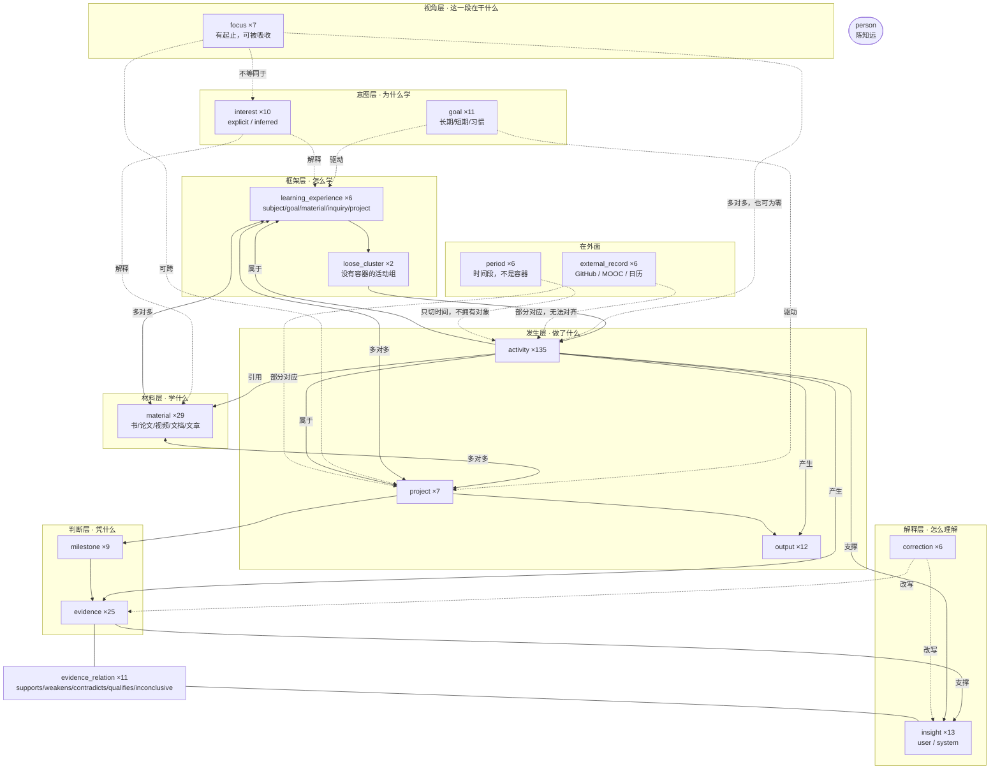

# 数据关系图 · 合成轨迹

> 配套 `synthetic-trajectory-data.json`。本文件只回答一件事：**这些对象是怎么连的**，
> 以及**哪几种连法一旦被压成层级就会出错**。

---

## 1. 一句话

**它不是一棵树。** 没有"这个人 → 这个空间 → 这门课 → 这章 → 这条记录"这样的单一主干，
因为现实里同一条记录会同时属于好几件事，而有些记录什么也不属于。

---

## 2. 骨架



实线 = 数据里真有 id 引用。虚线 = 概念上有关系，但没有稳定的一对一映射。

⚠️ 第二轮新加的两样东西都**不是**新层级：`focus` 是横切活动的视角（一条活动可挂 0、1 或多条），
`evidence_relation` 是证据与解释之间的连边（一条证据可支撑一个解释、同时削弱另一个）。

---

## 3.5 · Focus 是斜着切的一刀，不是上面一层

```
        foc-01 神经渲染 ──────────────┐
foc-02 表征 ──────────────────────┐   │
        foc-07 毕设 ─────────────────────┴───┐
                                           │
1月   2月   3月   4月   5月   6月   7月 ... 11月
   └── foc-04 数学 ──┘
                 └── foc-03 意识 ──┘        └─ foc-05 因果 ─┘
```

| 如果按层级做 | 会错在哪 |
|---|---|
| Focus ⊃ Activity（每个活动只属于一个线索） | 5 条活动是两条；39 条一条都没有 |
| Focus = Interest 的子类 | `foc-04` 没有对应兴趣；`foc-06` 关了 135 天后 `int-07` 才撤 |
| Focus 是 Project 的别名 | `foc-07` 有项目，`foc-05` 没有（它还挂着 8 条不属于任何课程的活动） |
| 关闭的 Focus 不再收活动 | `act-131`（06-07）、`act-135`（10-24）都在 `foc-01` 关门之后 |

---

## 3. 六种连法，以及它们的真实基数

| 关系 | 基数 | 真实例子 | 如果按一对多硬压会怎样 |
|---|---|---|---|
| material ↔ learning_experience | 多对多 | `mat-19`（Bengio）同时属于 `lx-01` 与 `lx-04` | 一本书只能挂一门课 ⇒ 跨域那一步消失 |
| material ↔ project | 多对多 | `mat-12` 同时属于 `prj-01`、`lx-05`，并被 `ev-03` 引用 | 同上 |
| project ↔ learning_experience | 多对多 | `prj-01` 是 `lx-05` 的主体，也被 `lx-06` 当练习场 | 一段学习只能有一个项目 |
| activity ↔ 对象 | **一对多，且常常为零** | `act-022`（群里问内参）不挂任何对象 | 强迫每条活动有归属 ⇒ 编造 |
| activity → evidence | 一对多，且常常为零 | `act-007` 产 `ev-01`；`act-005` 画草图，零证据 | 有活动就有证据 ⇒ 把点击当学习 |
| insight ← evidence / activity | 多对多 | `ins-02` 引 5 条活动 + 2 条证据 | 一条观察只能挂一条依据 ⇒ 无法追 |

**一物多面的三个实例**（`trajectory-inputs.md` §4.5 要求的东西，在这里是可查的）：

| 对象 | 它在几个维度上同时成立 |
|---|---|
| `mat-19` | 材料（Bengio 论文）· `lx-01` 的读物 · `lx-04` 的读物 · `prj-06` 的引用 · `ev-15` 的依据 · `int-02` 的早期信号 |
| `prj-01` | 项目 · `lx-05` 的主体 · 4 条证据的来源 · `int-01` 的载体 · 3 件产出的容器 · `ins-09` 的对象（且被更正过） |
| `out-09`（长文草稿） | 产出 · `prj-06` 的中间态 · `ev-10` 的载体 · `ins-08` 的产物 · `goal-07` 的进度 |

---

## 4. 两条不能画成父子关系的边

**① 时间不是容器。**
`period` 只是把日期切段，它不拥有对象。`lx-04` 从 3-27 横穿 `per-03` → `per-04` → `per-05` → `per-06`，
中间还跨过 35 天空档。任何"时期 → 事件"的树都会把它劈成四份。

**② 系统观察不是事实的子节点。**
`ins-04` 被用户否掉了，`ins-09` 被更正，`ins-10` 被撤回，`ins-05` 自己说"我不知道"。
如果把 insight 画成 activity 的派生节点，这些状态就没地方放——
它们不是"更多的事实"，是**关于事实的说法**。

---

## 5. 从图上推不出来的四件事

1. **因果**。`act-040`（重做第 5 章）在 `ev-02` 之后 61 天，但那不是"因为错了所以重做"的证据——
   中间还有 `act-034`（开了 Bishop 又停）。连线只能表达引用，不能表达"因此"。
2. **归属强度**。`ev-06` 引用了 `mat-27`（issue #214），所以那次"自己定位"的独立性是打折的。
   图上 `mat-27` 只是一条边，看不出它是**削弱**证据的边而不是支撑证据的边。
3. **缺失**。`act-014` 到 `act-015` 之间那两天（1-28 到 1-30）没有记录，
   图上看不出他是通宵还是在睡觉。空档不等于空白，也不等于没发生。
4. **同一件事的两种说法**。`ins-11`（"什么都没做成"）与 `ms-05`（答辩通过）指向同一段时间。
   图上它们是两个节点，谁也不覆盖谁——这是对的，但**渲染时必须让冲突可见**，否则读者只会看到其中一个。

---

## 6. 对 UI 的直接含义

| 如果界面这样组织 | 会丢什么 | 数据里能查到的反例 |
|---|---|---|
| 按 goal 分组 | 没有目标的活动（`act-022`、`act-054`）、已放弃目标下的残留对象 | `cluster-01` 因果推断 8 条活动，无 goal |
| 按 project 分组 | `lx-01`、`lx-03` 这两段阅读没有项目 | 12 条活动只挂材料 |
| 按 course 分组 | 两组 loose cluster；`out-12` 那封没发的邮件 | `cluster-02` |
| 按时间分组 | 长跨度对象的连续性（`lx-04` 会被切成 4 段） | `lx-04` 跨 219 天 |
| 按兴趣分组 | 假阳性兴趣（`int-06` 数学基础）与未确认兴趣（`int-04`）混在真兴趣里 | 4 条 inferred，1 条 confirmed |
| 只显示系统能读到的 | 27/104 条活动、2/29 件材料、10/12 件产出 | `visible` 字段可直接过滤对比 |
