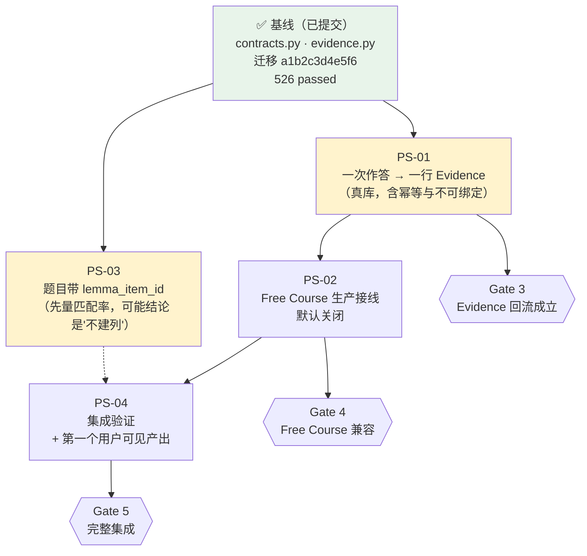

# Practice System — 实施路线图

> **分支** `practice-system` · **基线** `41e06d51`（从 `user-profile` 切出）
> **本文件生成时** HEAD = `ed39f142`
> **本次只做分解，不改代码、不迁移、不提交**（唯一的例外见 §1 的 `.gitignore`）

---

## 1 · 当前实施基线

### 1.1 已经做掉的（视为基线，不重做）

| 内容 | 提交 | 验证 |
|---|---|---|
| `services/practice/{contracts,evidence}.py` —— 统一评价契约 + 两道守卫 + 幂等 | `4a72ae83` | 10 条契约测试 |
| 迁移 `a1b2c3d4e5f6` —— `origin_kind` 放宽 + `context_kind` / `context_ref` | `4a72ae83` | 已对真库执行 + `pg_get_constraintdef` 回读 |
| 实施报告 + 下一步计划 | `5c67a7c9` / `ed39f142` | — |

**全量基线：`526 passed / 0 failed`**（固定顺序）。

### 1.2 实测的数据库现状（2026-11-11）

| 表 | 行数 |
|---|---|
| `questions` / `question_versions` | 10 / 10（`provider` 全为 `xkw_fixture`）|
| `question_sets` / `question_set_attempts` / `question_attempts` | **0 / 0 / 0** |
| `course_lesson_objects` | **12**（其中 **4 带 `concept`**）|
| `course_lesson_observations` | **0** |
| `knowledge_items` / `knowledge_evidence` | 11 / 4 |

### 1.3 两处已确认的「代码现实 vs 任务假设」

⚠️ **这两条是本次分解的关键输入，原始任务书里的假设与之不符。**

| 任务书的假设 | 代码现实 |
|---|---|
| 「Free Course 与题库有两套练习，通过薄接口协作」 | ✅ 成立，且上轮已建适配器 |
| 暗示题库有知识点可用于 Evidence | 🔴 **`questions.meta_json->'kpoints'` 实测为 `[]`**；而 `questions.objective` 是 **boolean**（`models/question.py:51`），**不是学习目标** |

⇒ **题库那条路今天接不通，不是守卫的问题，是数据里没有知识点。**
⇒ 而 `course_lesson_objects.concept` **有真实值** ⇒ **Free Course 是唯一可通的路。**

### 1.4 一处需要你批准的仓库改动

⚠️ `docs/` 在 `.gitignore` 里（`/docs/*`）⇒ **子计划文件不入库就等于只有一个人有**。
本轮已加放行：

```
!docs/plans/
!docs/plans/practice-system/
!docs/plans/practice-system/*.md
```

⚠️ **注意 gitignore 的一个特性**：否定规则必须写在 `/docs/*` **之后**才生效。
我在整理这个块时踩过一次（顺序颠倒导致整个 `docs/` 意外放行），已修回并逐个文件复验：
`docs/plans/practice-system/*.md` ✅ 可入库 · `docs/evidence/*.md` 仍被 ignore ✅。

---

## 2 · 子计划总表

| ID | 标题 | Gate | 硬依赖 | 能否并行 |
|---|---|---|---|---|
| [PS-01](./docs/plans/practice-system/PS-01-free-course-evidence-return.md) | Free Course Evidence 回流的真库验证 | **3** | 无 | ✅ 可与 PS-03 并行 |
| [PS-02](./docs/plans/practice-system/PS-02-free-course-wiring.md) | Free Course 生产接线（默认关闭） | **4** | PS-01 | ❌ 串行 |
| [PS-03](./docs/plans/practice-system/PS-03-question-knowledge-binding.md) | Questions 携带 Lemma item_id | 1 延伸 | 无 | ✅ 可与 PS-01 并行 |
| [PS-04](./docs/plans/practice-system/PS-04-integration-and-visible-outcome.md) | 集成验证 + 用户可见产出 | **5** | PS-01 + PS-02 | ❌ 串行 |

⚠️ **四个，不是五个或八个** —— 因为 Phase 0/1/2 已经做掉了，
剩下的链路只有「一次真实验证 → 一处接线 → 一条数据能力 → 一次集成」四段。

---

## 3 · 依赖关系图



### 依赖类型

| | |
|---|---|
| **Hard** | PS-02 → PS-01（幂等未证实时接线会写重复 Evidence）· PS-04 → PS-01+PS-02 |
| **Soft** | PS-03 可在 PS-01 期间做只读探针，**但迁移必须等 PS-01 跑完 smoke**（两者共用同一个库）|
| **Parallelizable** | **PS-01 与 PS-03 的代码完全不重叠**（`services/practice/` vs `models/questions`）⇒ 可派两个 Agent |
| ⚠️ **必须串行** | **提交必须串行** —— 两个 Agent 同写一个分支会互相污染，且谁先跑迁移会影响另一个的 smoke |

---

## 4 · Gate 定义与对应

| Gate | 判据 | 达成于 | 当前 |
|---|---|---|---|
| **0 · 安全基线** | 分支正确、工作区干净、基线测试已知 | ✅ `ed39f142` | ✅ 已达成 |
| **1 · Question Bank 可运行** | 组卷→答题→判分→落库可执行 | `scripts/smoke_qbank.py` ALL PASS | ✅ 已达成（16 项）|
| **2 · Attempt/Evaluation 契约成立** | 题目版本·作答·评价可稳定关联 | `contracts.py` + 10 条测试 | ✅ 已达成 |
| **3 · Evidence 回流成立** | ≥1 条有效可追溯结果进入现有 Evidence，且不被等同于掌握 | **PS-01** | 🔴 **未达成（从未有过一次真实写入）** |
| **4 · Free Course 兼容** | 现有练习通过明确边界参与共享契约，主流程无回归 | **PS-02** | 🔴 未达成 |
| **5 · 完整集成** | 集成测试 + 异常路径 + 持久化验证 | **PS-04** | 🔴 未达成 |

⚠️ **Gate 0/1/2 已达成不代表后面能自动达成** —— 3/4/5 依赖的是**真实数据流动**，
而这正是至今没有发生过的部分。

---

## 5 · 数据契约与接口冻结策略

### 5.1 已冻结（除非有先失败的测试，不许改）

| 契约 | 位置 | 冻结理由 |
|---|---|---|
| `PracticeEvaluation` 的 verdict 取值 | `services/practice/contracts.py` | 已有 10 条测试；`ungradable` 与 `unsupported` 分开是核心决定 |
| `counts_as_success` 返回 `True/False/None` | 同上 | 防止调用方把「部分对」静默变成 False |
| 两道守卫（无信号 / 无 item） | `services/practice/evidence.py` | 直接对应任务原话的两条禁令 |
| `verdict` 只能取 `correct`/`incorrect`/`no_verdict` | `models/knowledge.py:51` | **DB CHECK 强制**，不是我们的选择 |
| `item_label` 是合法入口 | `evidence_entry.py:131-133` | 上游既有约定 |

### 5.2 会在 PS-01 里**被验证**而不是被设计

⚠️ **幂等查询的 SQL 写法（`response_ref->>'practiceRef'`）尚未在真库跑过。**
若它不成立（索引/类型问题），PS-01 应改写它 —— 但**契约语义（一次 attempt 一次 evidence）不许变**。

### 5.3 各子计划的文件所有权（并行时防冲突）

| 计划 | 可写 | 禁止写 |
|---|---|---|
| PS-01 | `backend/scripts/smoke_practice_evidence.py`（新）· `services/practice/evidence.py`（仅缺陷修复）| 其他一切 |
| PS-02 | `free_course_service.py` · `core/config.py` · `.env.example` | `services/practice/*` |
| PS-03 | `models/question.py` · `question_bank_service.py` · 新迁移 · 新探针脚本 | `services/practice/*` · `free_course_service.py` |
| PS-04 | `api/v1/free_courses.py` · `schemas/free_course.py` · `frontend/src/features/free-course/*` | 上面三个计划的所有文件 |

---

## 6 · 风险与回滚

| 计划 | 可能破坏什么 | 早发现 | 回滚 |
|---|---|---|---|
| **PS-01** | 污染真实用户数据 · 幂等不成立 | 脚本打印将使用的 id · `DUPLICATE` 断言必须真实比较行数 | 删脚本；`--cleanup` 清库 |
| **PS-02** | **Free Course 提交行为改变** | 配置默认 `False` + 全量既有测试 | **配置置 False 即恢复，无需回退代码** |
| **PS-03** | 迁移不可回滚 · 拖慢组卷 · 破坏唯一约束 | `upgrade→downgrade→upgrade` 往返 · ⚠️ 不动 `(provider, external_id)` | `alembic downgrade -1`（新列可空、无数据依赖）|
| **PS-04** | 端点越权暴露他人作答 | 端点必须校验 ownership | revert 两个 commit，无迁移 |

⚠️ **唯一需要跨 Agent 协调的是数据库**：PS-01 与 PS-03 都写同一个本地库
⇒ **必须串行执行，或给其中一个单独的测试库。**

---

## 7 · Git 协作策略

| 规则 | 说明 |
|---|---|
| **每个子计划一个 commit** | 允许独立 commit，便于单点回退 |
| **数据契约只在 PS-01 冻结** | 之后任何改动必须有一个先失败的测试作为理由 |
| **阶段边界审查** | PS-02 与 PS-04 之间要人工看一次 diff（都碰 Free Course）|
| ⏔ **暂停条件** | ① 全量测试出现**先于本分支存在**的失败 ② `smoke_qbank.py` 不再 ALL PASS ③ 迁移 downgrade 失败 ⇒ **停下来查，不要继续叠加** |
| ❌ **禁止** | 多个 Agent 无约束地改同一个数据契约；自动合并到 `user-profile`；触发部署 |

⚠️ **已知的既有 flaky**：`tests/api/test_scheduled_tasks_api.py` 在**随机顺序**下会随机挂一条
（**先于本分支存在**，与 Practice 无关）。
⇒ **所有 pytest 命令必须带 `-p no:randomly`**，否则「全绿」会变成「偶尔红」。

---

## 8 · 推荐执行顺序

```text
第 1 步（并行）  PS-01  ‖  PS-03 的只读探针
                 ↓
第 2 步（串行）  PS-01 的迁移之后 → PS-03 的迁移
                 ↓
第 3 步（串行）  PS-02        ← 必须等 PS-01 证明幂等
                 ↓
第 4 步（串行）  PS-04        ← 必须等 PS-02
```

⚠️ **PS-03 的第 2 步可能得出「不建列」的结论**（如果 fixture 的 10 道题里能匹配的
是 0）。那不是失败 —— **那是本轮最有价值的一个数字**，它会告诉下一轮「映射」要花多少。

---

## 9 · 本轮明确不做

| | 为什么 |
|---|---|
| Subpractice / On-demand / Daily Quiz 页面 | 原任务禁止 |
| 自适应选题系统 | 原任务禁止；且 PS-03 的匹配率还没量 |
| AI 生成题目管线 | 原任务禁止 |
| 复杂主观题评分 | 原任务禁止 |
| 合并两套练习系统 | 原任务禁止，且**没有证据支持合并**（判分方式不同、生命周期不同）|
| 接 Learner State / Coordinator / Method | `turn_start` 零生产者 ⇒ 先得让决策层被咨询 |
| `question_sets` 加 `project_id` | 仍无第一个 surface 需要它 |
| User Profile 影响判分 | ⚠️ **Profile 只影响呈现，绝不进 `verdict`** |