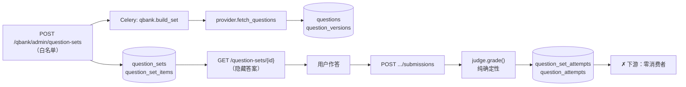

# Question Bank — 现状调查报告

> **基线** `user-profile @ 8979434e` · **日期** 2026-10-11 · **库** `lemma @127.0.0.1:55432`（已实测）
> **本轮零代码改动。**
>
> **下一步（≤5 行）**
> ① **存在一套完整的题库系统，但它从未被使用过** —— 六张表、十个 API、判分器、解析器全在，
>    而 `question_sets` / `question_set_attempts` / `question_attempts` **三张表各 0 行**。
> ② **数据被保存 ≠ 数据被消费**：`question_attempts` 存了作答与逐题判分快照，
>    **下游消费者数量为零**。`evidence_entry.py:19` 自己写着题库是「a future surface」。
> ③ **它与 User Profile 零连接**，与 Learner State 零连接，与 Global Agent 零工具，与 Space 零关系（**无 project_id**）。
> ④ **而且它现在有两套**：题库（纯确定性判分）与 Free Course 练习（本地判 + LLM 判），**零交集**。
> ⑤ 今天要做「题库 × 用户画像」的连接，**真正的第一格不是画像，是那三张 0 行的表**。

---

## 1 · Executive Summary

**当前题库系统处于「建成但未启用」阶段。**

它不是一个残缺的半成品 —— 它有完整的题目版本模型、题组模型、会话与尝试模型、
一个确定性的判分器、一个 HTML 解析器、六个 API、两套判分测试，以及一个
`/sandbox/quiz` 的前端页面。**从工程角度看它相当完整。**

但从使用角度看：**库里只有 10 道 fixture 题目，从未组过卷、从未答过题。**
而且这 10 道题的 `provider` 全是 `xkw_fixture` ⇒ **默认配置下抓的是离线假数据**。

⚠️ **它与 Lemma 的学习系统完全平行**：题目作答的结果不产生 Evidence、
不更新 Learner State、不被 Coordinator 选择、不进 Trajectory、也不带 Space 归属。

---

## 2 · Current System Map

### 2.1 六个模型（不是三个文件里的三个类）

| 表 | 模型 | 定义 | 关键列 |
|---|---|---|---|
| `questions` | `Question` | `models/question.py:24-73` | `provider` `:42` · `external_id` `:43` · `xkw_course_id` `:47` · `difficulty` `:52` · `difficulty_level` `:53` · **`stem_html` `:57`** · **`answer_html` `:58`** · **`explanation_html` `:59`** · `meta_json` `:61` |
| `question_versions` | `QuestionVersion` | `models/question.py:76-122` | `question_id` FK `:104` · `parser_version` `:107` · `view_json` `:110` · **`review_json` `:111`** · `slot_map_json` `:112` · `parse_status` `:113` · `is_current` `:119` |
| `question_sets` | `QuestionSet` | `models/question_set.py:12-65` | `user_id` FK `:42` · `kind` `:45` · `mode` `:46` · `status` `:48` · **`origin_kind` CHECK 只允许 `'dev'` `:33`** |
| `question_set_items` | `QuestionSetItem` | `models/question_set.py:68-93` | `question_set_id` `:82` · `question_version_id` **RESTRICT** `:85` · `order_index` `:90` |
| `question_set_attempts` | `QuestionSetAttempt` | `models/question_attempt.py:21-67` | `user_id` `:54` · `question_set_id` `:57` · `status`(`open`/`submitted`) `:61` |
| `question_attempts` | `QuestionAttempt` | `models/question_attempt.py:70-110` | `attempt_session_id` `:89` · `question_version_id` **RESTRICT** `:94` · `responses_json` `:99` · `slot_results_json` `:100` · `score_earned` `:101` · `status`(`graded`/`ungradable`/`pending`) `:103` |

**外键链**：
```
profiles ← question_sets ← question_set_attempts ← question_attempts
questions → question_versions ← {question_set_items, question_attempts}
```

### 2.2 三个服务

| 服务 | 文件 | 职责 |
|---|---|---|
| `question_bank_service` | `services/question_bank_service.py` | `upsert_question` `:84` · `ensure_current_version` · **只被 XKW 抓取任务调用** |
| `question_set_service` | `services/question_set_service.py` | 建组、列组、取答题视图 |
| `question_attempt_service` | `services/question_attempt_service.py` | 提交作答 `:94` → **服务端判分** `:143` → 落库 `:149-161` |

### 2.3 API（完整清单，六个）

**用户侧** `api/v1/question_sets.py`（前缀 `/question-sets`）

| 方法 | 路径 | 作用 | 写 |
|---|---|---|---|
| GET | `/question-sets` | 列自己的组 `:25-32` | 读 |
| GET | `/question-sets/{id}` | 取**答题视图**（隐藏答案）`:35-48` | 读 |
| POST | `/question-sets/{id}/submissions` | 提交 + 服务端判分 `:51-63` | **写** |

**管理侧** `api/v1/qbank_admin.py`（前缀 `/qbank/admin`，**全部要白名单** `require_qbank_admin` `:22-27`，白名单外返回 **404 假装不存在**）

| 方法 | 路径 | 作用 | 写 |
|---|---|---|---|
| POST | `/question-sets` | 建组 → 202 + 入队 `:30-64` | **写** |
| GET | `/catalog/courses` | 学科目录 `:75` | 读 |
| GET | `/catalog/courses/{id}/question-types` | 题型目录 `:83` | 读 |
| GET | `/catalog/courses/{id}/knowledge-tree` | 知识点树 `:92` | 读 |

⚠️ **没有找到**：创建题目 / 修改题目 / 删除题目 / 导入题目（CSV 或 JSON）的对外 API。
**组卷只能由白名单开发者发起，题目本体只能由后台任务从 XKW 抓。**

### 2.4 前端

| 位置 | 用途 |
|---|---|
| `features/question/questionApi.ts` | 题库 API 客户端 |
| `pages/CourseQuizSandboxPage.tsx` | 答题沙盒页 |
| 路由 `sandbox/quiz`（`AppRouter.tsx:222`，导航 `AppLayout.tsx:139`） | **沙盒，不是产品页** |
| `features/free-course/*` | **另一套**练习逻辑 |

⚠️ `features/conversation/ConversationQuizTool.tsx:14` 有一个接收 `questionSetId` 的卡片组件，
但**后端全仓 grep `question_set_id` 无任何下发处** ⇒ **这张卡片目前没有服务端数据源**（前端孤儿）。

---

## 3 · Data Model & Lifecycle

### 3.1 题目数据逐项

| 字段 | 状态 | 证据 |
|---|---|---|
| 题目 ID | ✅ | `questions.id` UUID |
| 题干 | ✅ | `stem_html` `:57`（**实测非空**）|
| 题型 | ✅ | `type_id` / `type_name` `:48-49`（实测值：单选题 / 实验探究题 / 多选题）|
| 选项 | ✅ | 在 `view_json` `:110` |
| 答案 | ✅ | `answer_html` `:58` + `review_json` `:111`（**实测非空**）|
| 解析 | ✅ | `explanation_html` `:59`（**实测非空**）|
| 学科 | ✅ | `xkw_course_id` `:47`（学段 × 学科）|
| **知识点** | ⚠️ **部分** | 只在 `meta_json` `:61`（注释说含 `kpoints`），**无顶层列、无外键** |
| **难度** | 🔴 **实际为空** | `difficulty` / `difficulty_level` 有列，**实测 10 行全为 `None`** |
| 来源 | ✅ | `provider` + `source_kind` + `raw_hash` + `fetched_at` |
| 标签 | ⚠️ 部分 | 只在 `meta_json` |
| 相关材料 | 🔴 **未实现** | `media_flag` `:54` 只是一个布尔标记，**没有关联表** |
| 评分规则 | ✅ | `slot_map_json` `:112`（判分槽位表）|

**题目 ↔ 答案 ↔ 解析的关联是稳定的**：三者不是内嵌在一个 JSON 里，
而是通过 `QuestionVersion` **版本化**绑定；`question_versions` 的文档字符串
（`models/question.py:80-82`）明说**版本永不重写，组与尝试各自钉住自己那一版**。

⚠️ **但没有「失效 / 下架」标记**，也没有题目版本之间的内容差异记录。

### 3.2 生命周期

```
XKW 学科网（provider: http | fixture）
   ↓  tasks/question_set_build.py:133 provider.fetch_questions(...)
   ↓  :77 upsert_question → :80 ensure_current_version
questions + question_versions          ← 抓取即持久化（本地副本是判分/审计的唯一依据）
   ↓  仅白名单开发者：POST /qbank/admin/question-sets
question_sets + question_set_items
   ↓  GET /question-sets/{id}（隐藏答案）
   ↓  POST /question-sets/{id}/submissions
question_set_attempts + question_attempts（含判分快照）
   ↓
   ✗ 到此为止 —— 下游消费者为零
```

| 环节 | 结论 |
|---|---|
| 题目来源 | 🔴 **只有 XKW 抓取一条路**。AI 生成 / 人工创建 / CSV 导入 **全部没有找到** |
| 默认 provider | 🔴 `core/config.py:289` `qbank_xkw_provider = "fixture"` ⇒ **默认离线** |
| 谁写 `questions` | 唯一写方是 Celery 任务 `tasks/question_set_build.py:77`；**没有 HTTP 请求路径直接写题** |
| 是否持久化 | ✅ 是，且题目全局共享（`(provider, external_id)` 唯一，`:36`）|
| 如何筛选 | ⚠️ **只有组卷时的 spec**（`qbank_admin.py:42-49`：学科 / 知识点 / 难度 / 题型 / 数量），**没有「浏览/搜索题目」的 GET** |
| 如何作答 | 前端提交 → `question_attempt_service.submit()` `:94` → 本地判分 `:143` |
| 如何判分 | ✅ **纯确定性，非 LLM**：`qbank/grading/judge.py:136` → 选择题比选项集合 `:126` · 填空 `text_matches` `:130` · 判断题比布尔 `:132` · essay 直接 `not-graded` `:110-111`。**全文件 grep `gemini\|llm\|prompt` 零命中** |
| 结果存哪 | `question_attempts`（设计为快照，历史不依赖重判）|
| 能否复用同一道题 | ✅ 能。不同用户建组指向同一批 `QuestionVersion`；**「题目本身」= `questions`+`question_versions`，「每次尝试」= `QuestionSetAttempt`（会话）+ `QuestionAttempt`（每题一行）** |

### 3.3 「同一道题 vs 每次尝试」—— 区分清楚了，但少一个维度

| 维度 | 怎么区分 | 依据 |
|---|---|---|
| 不同用户 | ✅ `QuestionSet.user_id` + `QuestionSetAttempt.user_id` | `:42` / `:54` |
| 不同次练习 | ✅ `QuestionSetAttempt`（会话）+ 部分唯一索引「每人每 set 至多一个 open」 | `:36-42` |
| **不同 Learn Space** | 🔴 **不能** | ⚠️ **`QuestionSet` 没有 `project_id` / space 字段**（`question_set.py:39-61` 全部列可见）|

⇒ **实际限制**：一道在某个空间里练过的题，**无法被这个空间再次引用**，
也无法按空间统计作答历史；而 Space 是 Lemma 的核心容器，
「这道题是为了这个空间的目标而练的」这个关系**在数据层无处可存**。

---

## 4 · Runtime Data Flows

### Flow 1 · 组卷 → 答题 → 判分（**唯一闭合的一条**）



**已验证**：①–⑥ 全部代码确认；**⑦ 未验证**（库里 0 行）。

### Flow 2 · 作答 → 学习系统（**不存在**）

```
question_attempts.slot_results_json
   ├─→ evidence_entry / admit_outcome      ✗ 没有调用
   ├─→ knowledge_service（Learner State）  ✗ grep question 在 knowledge_service 零命中
   ├─→ Coordinator                         ✗ 无引用
   ├─→ space_goal                          ✗ grep 零命中
   └─→ Trajectory                          ✗ 无数据
```

⚠️ **最直接的证据**：`services/evidence_entry.py:19` 有一句注释 ——
> `A future surface (a course, a question bank) adds a prefix`

⇒ **题库被代码自己列为「未来」，不是被遗漏。**

---

## 5 · Integration Matrix

| Connection | Current Status | Evidence | Missing Link |
|---|---|---|---|
| Question → **User Profile / User Home** | 🔴 **NOT_CONNECTED** | 全仓 grep：题库任何文件不 import `user_home_*`；组卷 spec 的参数只有 XKW 目录 id | **没有接口、没有字段消费**。User Home 的 interests/preferences **完全不参与**组卷或选题 |
| Question → **Goal** | 🔴 **NOT_CONNECTED** | `space_goal_service.py` grep `question\|quiz` **零命中**；`QuestionSet` 无 `project_id` | 组卷不知道「这个空间的目标是什么」 |
| Question → **Learner State**（选题方向） | 🔴 **NOT_CONNECTED** | `knowledge_service.py` grep `question\|quiz` **零命中** | 组卷的 `kpoint_ids` 是 **XKW 目录 id**，与 `knowledge_items` **没有任何映射代码** ⇒ **两套知识点命名空间互不相通** |
| Answer → Evaluation | ✅ **SUPPORTED** | `question_attempt_service.py:143` → `judge.grade()` `judge.py:136` | ⚠️ essay 类题直接 `not-graded` ⇒ **主观题无判分** |
| Evaluation → **Evidence** | 🔴 **NOT_CONNECTED** | `evidence_entry.py:19` 自述题库是「future surface」 | 作答结果不进证据层 |
| Evidence → Learner State | ⚠️ **链本身通，题库接不上** | `admit_outcome`（`evidence_entry.py:141`）与 `compute_state` 完整 | 只差题库这一条接入线 |
| Question → **Method / Coordinator** | 🔴 **NOT_CONNECTED** | `ai/tools/declarations.py:21-40` 的工具清单里**没有任何出题/组卷工具**；`conversation_tool_service.py` grep `question\|quiz` **零命中** | Agent 不能出题；Coordinator 不知道题库存在 |
| Question → **Space Context / Memory** | 🔴 **NOT_CONNECTED** | 题库不 import 任何 space 模块；`QuestionSet` 无 space 字段 | 题目不能用空间里的材料 |
| Question → **Trajectory** | 🔴 **NOT_CONNECTED** | 题库不产生任何 trajectory 可读的数据 | — |
| Question → **Free Course 练习** | 🔴 **两套零交集** | `course_lesson_objects` / `course_lesson_observations` 与 `questions` 无任何 FK 或 import | **判分策略也不同**（见下） |

### ⚠️ 两套题目系统的判分策略不一致

| | 题库 | Free Course 练习 |
|---|---|---|
| 题目存哪 | `questions` + `question_versions` | `course_lesson_objects` `:146-153` |
| 作答存哪 | `question_attempts` | `course_lesson_observations` `:159-186` |
| **判分** | **纯确定性**（`judge.py`，无 LLM） | **本地判 + LLM 判**：客观题本地比对 `free_course_service.py:585-587`，**开放式题交给模型** `:592`，反馈由 `explain_answer()` `:594-603` 生成 |
| 有 `is_correct` 吗 | 🔴 **没有布尔列**，只有 `slot_results_json` 里的 per-slot `verdict` | ✅ **有** `:184` |
| 进 Evidence 吗 | ❌ | ❌ **只被 `count(distinct object_id)` 统计覆盖率**（`free_course_service.py:722` / `free_course_events.py:553`）|

⚠️ **两套都没有闭环，但它们连「答题记录」这个概念都不共享。**

---

## 6 · User Capability Matrix

⚠️ **实测支撑**：`questions` **10 行**（`provider` 全为 `xkw_fixture`）·
`question_versions` 10 行（`parse_status=parsed`、`fully_auto=True`、题干/答案/解析/view/review/slot **全部非空**）·
⚠️ **`question_sets` / `question_set_items` / `question_set_attempts` / `question_attempts` 各 0 行。**

| 能力 | 状态 | 证据 |
|---|---|---|
| 查看题目 | `PARTIALLY_SUPPORTED` | ✅ 代码完整（答题视图脱敏 `:35-48`）；⚠️ **仅沙盒页**，且库中 0 组卷 ⇒ **无真实使用证据** |
| 搜索题目 | `NOT_IMPLEMENTED` | **没有 GET 接口**；筛选只存在于组卷 spec |
| 按学科 / 知识点筛选 | `PARTIALLY_SUPPORTED` | 组卷 spec 支持（`qbank_admin.py:42-49`），但**仅白名单开发者**；`GET /catalog/*` 三个目录接口存在 |
| 创建题目 | `NOT_IMPLEMENTED` | 无 API。只能由后台任务从 XKW 抓 |
| 修改题目 | `NOT_IMPLEMENTED` | `question_bank_service` 只有 `upsert_question`（被 XKW 纠错触发，不对外） |
| 删除题目 | `NOT_IMPLEMENTED` | 无 service 函数、无路由 |
| 导入题目 | `NOT_IMPLEMENTED` | 未找到 CSV / JSON 导入路径 |
| 生成题目 | `NOT_IMPLEMENTED` | **无 AI 生成**；默认 provider 还是 fixture |
| **回答题目** | `BACKEND_ONLY` ⚠️ | ✅ 服务端判分完整且测试覆盖；🔴 **但库里 0 次作答，前端页面是 `/sandbox/quiz` 沙盒** |
| 获取反馈 / 评分 | `PARTIALLY_SUPPORTED` | ✅ 客观题有分与逐题 verdict；🔴 **essay 直接 `not-graded`**；❌ **无「为什么错」的讲解**（题库侧） |
| **查看历史答题** | `BACKEND_ONLY` ⚠️ | 数据模型支持（`QuestionSetAttempt` 按 user 隔离 + 部分唯一索引），但🔴 **0 行，且前端无历史页** |
| 重新练习 | `NOT_IMPLEMENTED` | 无「重新生成同组」或「错题重练」入口 |
| **根据学习情况获得题目** | `NOT_IMPLEMENTED` | **无任何按状态选题的逻辑** |

⚠️ **「回答题目」标 `BACKEND_ONLY` 而不是 `SUPPORTED` 的理由**：
判分链路完整、测试齐全，**但库中 0 次作答、前端只有沙盒页** ⇒
**没有任何证据表明它被真实使用过一次。**

---

## 7 · Verified End-to-End Scenarios

### 场景 · 题库判分（**唯一能走通的，且是代码级确认**）

| 步 | 状态 | 依据 |
|---|---|---|
| 1. 开发者建组 | ✅ 代码确认 | `qbank_admin.py:30-64` → 202 + 入队 |
| 2. 后台抓题并落库 | ✅ **实测有数据** | `questions` 10 行 · `question_versions` 10 行 · `parse_status=parsed` |
| 3. 取答题视图（脱敏） | ✅ 代码确认 | `question_sets.py:35-48` |
| 4. 用户作答 | ⚠️ **代码确认，运行未验证** | 库中 0 行 |
| 5. 服务端判分 | ✅ 代码 + 测试确认 | `judge.py` + `tests/qbank/test_grading.py` |
| 6. 落库 | ✅ 代码确认 | `question_attempt_service.py:149-161` |
| 7. **后续学习流程使用** | ❌ **未实现** | **第一个断点在这里** |

⚠️ **测试证据的性质**：`tests/qbank/test_api.py:1` 首行自述 **"needs no database"**，
`tests/qbank/` 全目录 grep `asyncpg|postgres|create_all` **零命中**。
真正的端到端验证在**独立脚本** `scripts/smoke_qbank.py`
（覆盖建组 / 答题视图 / IDOR 404 / 版本过期 409 / 重复提交 409 / 422 / 会话恢复），
⚠️ 但它**默认用 fixture provider 且不在 CI**，**我没有找到它被实际执行过的记录**。

### 场景 · Free Course 练习（**前 6 步通，第 7 步断**）

| 步 | 状态 |
|---|---|
| 1–2. 生成课程与练习对象 | ✅ |
| 3. 展示练习 | ✅ |
| 4. 提交作答 | ✅ `free_course_service.py:541` |
| 5. 判分（客观题本地 / 开放题 LLM） | ✅ `:585-603` |
| 6. 落库（含 `verdict` / `is_correct` / `feedback`） | ✅ `:605` |
| 7. **后续学习流程使用** | ❌ **只被 `count()`**（`:722`）|

⚠️ **两个场景在第 7 步同时断，而且是同一种断法**：
**答了、判了、存了，然后没有任何东西读它。**

---

## 8 · Critical Gaps

按对「今天开展题库 × 用户画像连接工作」的影响排序。

### G-1 · 三张核心表 0 行 —— **先有使用，再谈连接** 🔴

`question_sets` / `question_set_attempts` / `question_attempts` **各 0 行**。

⚠️ **这不是缺陷，是「还没开始用」** ⇒ **任何「让题库读画像」的工作，
在没有真实作答数据之前都无法验证效果。** 今天第一件该做的事不是连接，
而是**让一个人真的组一次卷、答一次题**（哪怕在沙盒里）。

### G-2 · 题目不带 Space 归属 🔴

`QuestionSet` 无 `project_id`。⇒ 「这道题是为了这个空间的目标而练的」在数据层无处可存，
**也无法按空间统计历史**。

⚠️ **这是「题库 × Learn Space」的第一块砖**，也是它与 Free Course 并存时最别扭的地方
（Free Course 的内容天然属于一个课程，题库的题目不属于任何东西）。

### G-3 · 两套知识点命名空间不通 🔴

组卷 spec 用 **XKW 目录 id**（`kpoint_ids` / `catalog_ids`），
Learner State 用 `knowledge_items.id`（UUID）⇒ **两套 ID 之间没有映射代码。**

⇒ **「按用户薄弱点抽题」这件事今天在技术上不可能**，因为
「用户薄弱点」和「能抽的题」用的是两把不同的尺子。

### G-4 · 作答结果不进 Evidence 🔴

`services/evidence_entry.py:19` 自述题库是「future surface」。
⇒ 判分做得再好（它是**纯确定性**的，比 Free Course 的混合判分更可靠），
**也只是一个没有人读的数字。**

⚠️ **值得注意的是**：题库的判分结果**比 Free Course 的更适合做 Evidence**
（`slot_results_json` 是逐槽位快照、有 `score_earned/score_total`、服务端判、无 LLM 噪声）。
⇒ **如果要接一条，先接题库这条而不是 Free Course 那条。**

### G-5 · 难度字段实际为空 🟡

`difficulty` / `difficulty_level` 有列，**实测 10 行全 `None`**。
⇒ 「按难度选题」在数据上还没有原料。

### G-6 · 主客观混合、主观题无判分 🟡

essay 类直接 `not-graded`（`judge.py:110-111`），
而题库侧**没有 Free Course 那样的 LLM 解释** ⇒
**答了主观题的用户得不到任何反馈**。

### G-7 · 默认 provider 是 fixture 🟡

`core/config.py:289`。⇒ **即使接通了，默认配置下用的还是离线假数据。**

---

## 9 · Open Questions

| # | 问题 | 为什么必须先定 |
|---|---|---|
| Q-1 | **题库要成为 Learn Space 的一部分，还是继续作为独立的练习工具？** | 决定要不要加 `project_id`，也决定它与 Free Course 的关系 |
| Q-2 | **XKW 目录 id 与 `knowledge_items` 怎么映射？**（人工映射表 / 抓取时对齐 / 让题目直接带 Lemma 知识点） | **G-3 的唯一解**；不定这个，「按薄弱点选题」无法开工 |
| Q-3 | **两套题目系统要合并吗？** | 不合并就要接受「两套判分策略、两套答题记录、两个前端」长期并存 |
| Q-4 | **题目的来源策略**：继续依赖外部题库，还是允许 AI 生成？ | 影响是否需要 AI 出题工具（当前 Agent 工具清单里没有） |
| Q-5 | **主观题要不要判？** 若要，判分结果算不算 Evidence？ | 关系到 Evidence 的可靠性边界 |
| Q-6 | **`origin_kind` 的 CHECK 只允许 `'dev'`**（`question_set.py:33`）—— 是否放开到 course / conversation？ | 这一个 CHECK 决定题库能不能被业务流程创建 |

---

## 10 · Next-Step Recommendations

⚠️ **只给最小必要的一步，不给重构方案。**

### 第一步（今天可做，零代码）：**让一个人真的答一道题**

用现有的 `/sandbox/quiz` + 白名单组卷，**人工答一次**，然后查库确认
`question_attempts` 真的落了一行。

**为什么这是第一步**：G-1 决定其余六项**全部无法验证** ——
在没有真实作答数据前，「题库读画像」这件事只能写成代码，不能被证明有效。

⚠️ **同时确认 `difficulty_level` 为什么是空的**（G-5）—— 如果 fixture 数据本来就没有难度，
那换真 provider 后是否会有，是个未知。

### 第二步：把 XKW 知识点映射到 `knowledge_items`（G-3 的最小解）

⚠️ **不新建映射服务**。最小做法是**在组卷 spec 里允许直接传 Lemma 的知识点 id**，
由题库按 `objective` 或 `meta_json.kpoints` 反查 —— 先看能不能对上，
**对不上再决定要不要一张映射表。**

**验收**：能用一个 `knowledge_items.id` 组出一组题。
⚠️ 若反查准确率很低，**那才是「需要映射表」的证据**，而不是现在就建表。

### 第三步：把一次作答接进 Evidence（G-4）

把 `question_attempts.slot_results_json` 里**一道题**的 verdict 送进
**已存在的** `admit_outcome`。

⚠️ **顺序上这一步应在第二步之后** —— 因为 `admit_outcome` 的
`resolve_item` 要求知识点已存在，而 G-3 未解之前不知道该传哪个知识点。
⚠️ 同 `EVIDENCE_FLOW.md` §8 的第一阶段：**不新建机制，只接线**。

### 明确不该现在做的

| | 为什么 |
|---|---|
| 合并两套题目系统 | Q-3 未决；且合并成本远大于今天的收益 |
| 建 XKW↔Lemma 映射表 | **先做第二步的验证**，用失败率决定要不要建 |
| 给 Agent 做出题工具 | 在「谁来决定抽哪道题」有答案之前，多一个工具只是多一条断线 |
| 题目版本管理 / 失效标记 | 目前 `questions` 只有 10 行 fixture，**没有规模问题** |
| 主观题判分 | 需要先定 Q-5（判分结果算不算 Evidence）|

---

## 附 · 未能验证的部分

| | 什么 | 为什么 |
|---|---|---|
| U-1 | **`smoke_qbank.py` 是否真跑过** | 无日志、无产物、无 CI 记录 |
| U-2 | 前端答题页在真实浏览器里的表现 | 需登录（云端 Supabase）⇒ **本轮无 runtime 观察** |
| U-3 | `difficulty_level` 为空是 fixture 缺还是解析丢 | 需换真 provider 再抓一次 |
| U-4 | 题库与 Free Course 在产品意图上是否本就设计成两套 | 🔴 **仓库里没有任何文档说明这一点** |

⚠️ **U-4 值得单独说**：题库（`FREE_COURSE_*` 之外的独立子系统）与 Free Course 练习
**零交集、判分策略不同、前端分开**，而**没有任何文档解释这是设计还是历史遗留**。
⇒ 这是本报告里唯一一个**无法从代码判断意图**的问题，需要人来回答。